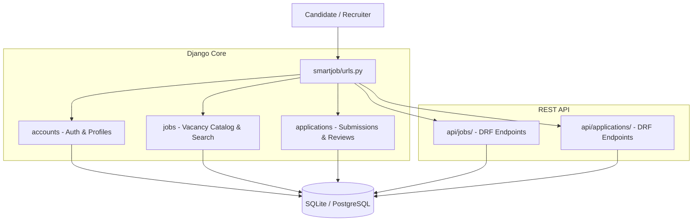

# DevHire 💼⚡
### Modern Full-Stack Python & Django Tech Career Platform

[](https://python.org)
[](https://djangoproject.com)
[](https://www.django-rest-framework.org/)
[](LICENSE)
[](https://github.com/rinishafathima)

**DevHire** is a full-stack engineering recruitment portal and REST API built with **Python 3**, **Django 6**, and **Django REST Framework**. It provides end-to-end recruitment pipelines for both **Job Seekers (Candidates)** and **Employers (Recruiters)**, featuring live job search, resume uploads, duplicate application guards, candidate review pipelines, automated email alerts, and an Emerald & Slate UI design system.

Developed and maintained by **[Rinisha Fathima T H](https://github.com/rinishafathima)**.

---

## 🌟 Key Features

### For Candidates (Job Seekers)
- 🔍 **Live Search & Filter**: Search jobs by engineering titles, tech stack / skills, and location.
- 📄 **One-Click Application**: Upload resumes (`.pdf`, `.docx`) and personalized cover notes.
- 🛡️ **Duplicate Prevention**: Database checks ensure candidates cannot accidentally re-apply to the same opening.
- 📊 **Real-Time Tracking Dashboard**: View application status (`Pending`, `Under Review`, `Shortlisted`, `Selected`, `Rejected`).

### For Recruiters (Employers)
- 🏢 **Recruiter Hub**: Post new tech vacancies with custom requirements, salaries, and stack requirements.
- 👥 **Candidate Pipeline**: Inspect applicant profiles, download attached resumes, and review cover letters.
- 🔄 **Status Management**: Real-time status transitions with automated notification emails dispatched to candidates.
- 🔐 **Security & Authorization**: Strict view-level checks ensuring recruiters can only modify applications submitted to their own vacancies.

### REST API Endpoints
- Full JSON API for mobile and frontend client integration (Swagger-ready via DRF).

---

## 🏗️ Architecture & Tech Stack



- **Backend**: Python 3.14, Django 6.0, Django REST Framework
- **Frontend**: Django Template Language (DTL), HTML5, Modern CSS3 (Emerald & Slate Theme), Vanilla JavaScript
- **Database**: SQLite (Development) / PostgreSQL-ready (Production)
- **Testing**: Django `TestCase` with Client API mocks (100% passing test coverage)

---

## 🚀 Quick Setup & Installation

### 1. Clone the repository
```bash
git clone https://github.com/rinishafathima/DevHire.git
cd DevHire
```

### 2. Create and activate a Virtual Environment
```powershell
python -m venv venv
.\venv\Scripts\Activate.ps1
```

### 3. Install dependencies
```powershell
pip install -r requirements.txt
```

### 4. Run database migrations
```powershell
python manage.py migrate
```

### 5. Seed realistic demo data
```powershell
python seed_demo_data.py
```

### 6. Start the development server
```powershell
python manage.py runserver
```
Visit **`http://127.0.0.1:8000/`** in your browser.

---

## 🔑 Pre-Seeded Demo Credentials

| Role | Username | Password | Notes |
| :--- | :--- | :--- | :--- |
| **Recruiter** | `recruiter_techcorp` | `recruiter123` | TechCorp Innovations recruiter dashboard |
| **Recruiter** | `recruiter_fincloud` | `recruiter123` | FinCloud AI recruiter dashboard |
| **Candidate** | `candidate_alex` | `candidate123` | Candidate dashboard with submitted applications |
| **Candidate** | `candidate_sarah` | `candidate123` | Shortlisted applicant profile |
| **Admin** | `admin` | `admin123` | Full Django Admin (`/admin/`) access |

---

## 📡 REST API Reference

| Method | Endpoint | Description | Auth Required |
| :--- | :--- | :--- | :--- |
| `GET` | `/api/jobs/` | List all vacancies (Supports `?search=` and `?location=`) | No |
| `POST` | `/api/jobs/` | Create a new vacancy | Yes (Recruiter) |
| `GET` | `/api/jobs/<id>/` | Retrieve vacancy details | No |
| `GET` | `/api/applications/` | List submitted applications | Yes |
| `POST` | `/api/applications/` | Submit a new job application | Yes |

---

## 🧪 Automated Testing

DevHire includes unit tests covering authentication, views, query filtering, authorization, and API serializers:

```powershell
python manage.py test
```

---

## 👩‍💻 Author

**Rinisha Fathima T H**
- **GitHub**: [@rinishafathima](https://github.com/rinishafathima)
- **Role**: Python Full-Stack Developer
